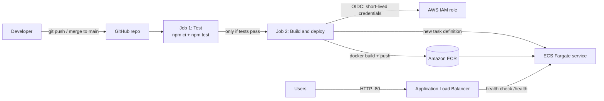

# Node.js CI/CD Pipeline to Amazon ECS Fargate


Every push to `main` automatically **tests** a Node.js app, packages it with **Docker**, pushes the image to **Amazon ECR**, and rolls it out to **Amazon ECS Fargate** behind an **Application Load Balancer**, with no downtime.

All AWS infrastructure is built with **Terraform**, and GitHub Actions signs in to AWS with **OIDC**, so **no AWS access keys are stored in GitHub**.

---

## Architecture



## Tech stack

| Area | Tools |
|---|---|
| App | Node.js 20, Express, Node built-in test runner |
| Container | Docker (`node:20-alpine`, runs as non-root `node` user) |
| CI/CD | GitHub Actions |
| Cloud | Amazon ECR, ECS Fargate, Application Load Balancer, VPC, IAM, CloudWatch Logs |
| Infrastructure as Code | Terraform (AWS provider ~> 5.0) |
| Auth | GitHub OIDC → IAM role (no stored keys) |

## Repository structure

```
node-ecs-pipeline/
├── .github/workflows/deploy.yml   # The CI/CD pipeline
├── app.js                         # Express app: "/" and "/health"
├── server.js                      # Starts the app on PORT (default 3000)
├── test/app.test.js               # Health check test
├── package.json / package-lock.json
├── Dockerfile                     # How the app is packaged
├── .dockerignore / .gitignore
└── terraform/
    ├── providers.tf               # AWS provider and default tags
    ├── variables.tf               # Region, project name, port, GitHub repo
    ├── network.tf                 # VPC, 2 public subnets, IGW, security groups
    ├── ecr.tf                     # Image registry
    ├── alb.tf                     # Load balancer, target group, /health check
    ├── ecs.tf                     # Cluster, task definition, service, logs, IAM
    ├── oidc.tf                    # GitHub OIDC provider + deploy role
    └── output.tf                  # URLs and names used by the pipeline
```

## How the pipeline works

Triggered on every push to `main` (or manually with **Run workflow**).

**Job 1: Test**
1. Check out the code
2. Set up Node.js 20
3. `npm ci`: install exact dependency versions
4. `npm test`: if this fails, the pipeline stops and nothing is deployed

**Job 2: Build and deploy** (runs only if tests pass)
1. Log in to AWS with OIDC (temporary credentials, about 1 hour)
2. Log in to Amazon ECR
3. Build the Docker image and push it, tagged with the **commit SHA**
4. Download the current ECS task definition
5. Swap in the new image
6. Register the new task definition and update the ECS service
7. Wait until the new version is healthy behind the load balancer

ECS uses a rolling deployment (`minimum 100%`, `maximum 200%`): the new container starts and passes health checks **before** the old one is stopped, so there is no downtime.

## Security: OIDC instead of access keys

GitHub Actions requests a signed token from GitHub and exchanges it with AWS STS for short-lived credentials. The IAM role only trusts tokens that:

- are issued for `sts.amazonaws.com` (`aud`), and
- come from **this repo's `main` branch** (`sub`).

The role has **least-privilege** permissions: push to this one ECR repository, register task definitions, update this one ECS service, and pass the task execution role to ECS only.

## Run it yourself

### Prerequisites
AWS account, GitHub account, Git, Node.js 20+, Docker, Terraform, AWS CLI (`aws configure` with an admin user for your laptop).

### 1. Run the app locally
```bash
npm install
npm test
npm start            # http://localhost:3000 and /health
```

### 2. Run it in Docker
```bash
docker build -t node-ecs-pipeline:local .
docker run --rm --init -p 3000:3000 node-ecs-pipeline:local
```

### 3. Build the AWS infrastructure
Set `github_repo` in `terraform/variables.tf` to your own `owner/repo`, then:
```bash
cd terraform
terraform init
terraform plan
terraform apply
```

### 4. Push the first image by hand
ECS needs an image in ECR before it can start (the pipeline can't push one until everything exists):
```bash
ECR_URL=$(terraform -chdir=terraform output -raw ecr_repository_url)
aws ecr get-login-password --region us-east-1 | docker login --username AWS --password-stdin ${ECR_URL%%/*}
docker tag node-ecs-pipeline:local $ECR_URL:latest
docker push $ECR_URL:latest
```

### 5. Add GitHub repository variables
**Settings → Secrets and variables → Actions → Variables**, using the Terraform outputs:

| Variable | Example |
|---|---|
| `AWS_ROLE_ARN` | `github_actions_role_arn` output |
| `AWS_REGION` | `us-east-1` |
| `ECR_REPOSITORY` | `node-ecs-pipeline` |
| `ECS_CLUSTER` | `node-ecs-pipeline-cluster` |
| `ECS_SERVICE` | `node-ecs-pipeline-service` |
| `TASK_DEFINITION_FAMILY` | `node-ecs-pipeline` |
| `CONTAINER_NAME` | `app` |

### 6. Push to `main` and watch the **Actions** tab.

## Rollback

**Quick rollback**: point the service at an earlier task definition revision (old images stay in ECR):
```bash
aws ecs update-service --cluster node-ecs-pipeline-cluster \
  --service node-ecs-pipeline-service --task-definition node-ecs-pipeline:<revision>
aws ecs wait services-stable --cluster node-ecs-pipeline-cluster --services node-ecs-pipeline-service
```

**Proper rollback**: undo the change in Git and let the pipeline redeploy:
```bash
git revert <commit>      # use -m 1 for a merge commit
git push
```

## Lessons learned

- **Green tests don't mean the deploy works.** The test job never touches AWS; the deploy job failed at the AWS login.
- **OIDC `sub` claims must match exactly.** The login failed with `Not authorized to perform sts:AssumeRoleWithWebIdentity` because:
  1. a placeholder username was never replaced in the trust policy, and
  2. GitHub's token `sub` included **immutable owner and repo IDs**: `repo:<owner>@<owner-id>/<repo>@<repo-id>:ref:refs/heads/main`.

  I found it by adding a temporary workflow step that printed the token's `sub` and `aud` claims, then updated the trust policy to accept both formats.
- **Chicken-and-egg:** ECS needs an image before the pipeline exists, so the first image is pushed manually.
- **Let the pipeline own the task definition:** `lifecycle { ignore_changes = [task_definition] }` stops Terraform from rolling back deployments.

## Cost and cleanup

While running, the load balancer, Fargate task and public IPs cost roughly **$1–2 per day**. Tear everything down when finished:
```bash
cd terraform
terraform destroy
```

## Author

**Olawale Adebayo**: [GitHub](https://github.com/Olawale-adebayo)